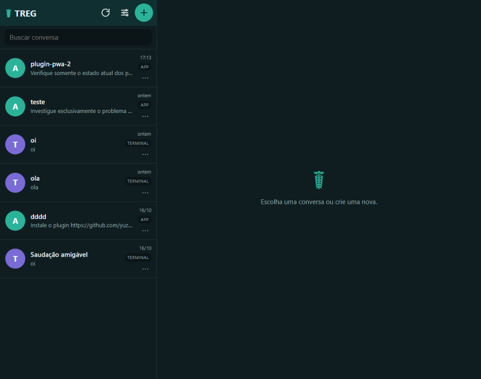
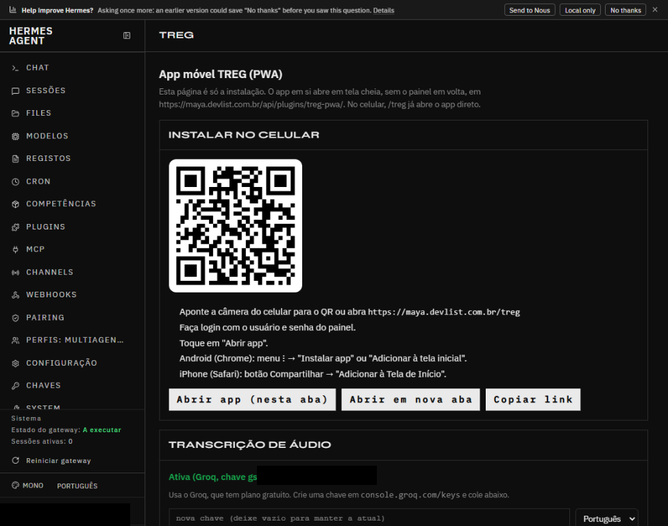

# 17 — Levantamento visual do TREG PWA e referências do WhatsApp

## 1. Objetivo e escopo

Documentar visualmente o estado atual do TREG PWA, registrar as áreas acessíveis, organizar capturas de tela e reunir referências visuais públicas do WhatsApp para orientar a futura fase de estrutura e design.

Esta fase foi exclusivamente de inspeção. Não alterou código, não reinstalou o plugin, não modificou configurações persistentes do aplicativo, não acessou a VPS e não publicou commits, tags ou releases.

> **Correção de 2026-10-19:** as imagens oficiais do WhatsApp citadas na seção 4.2 não estão presentes no workspace e não foram publicadas. As fontes externas foram mantidas, mas os embeds locais foram removidos. A captura da lista do TREG passou a apontar para `captura-15012.png`. A análise visual consolidada está nos relatórios 18 e 19.

## 2. Ambiente e ferramentas

| Item | Resultado |
|---|---|
| Aplicativo | `https://maya.devlist.com.br/api/plugins/treg-pwa/` |
| Página de instalação | `https://maya.devlist.com.br/treg?stay=1` |
| Navegador de inspeção | Chrome autenticado do usuário, via Browser MCP |
| Viewport das capturas do app | 975 × 768 px |
| Autenticação | Sessão existente do dashboard; o app abriu sem pedir login |
| Painel | Usuário autenticado no dashboard; Hermes exibido como v0.22.2 |
| Playwright | Usado apenas em páginas públicas; não compartilhou a sessão autenticada do Browser MCP |
| Teste do Playwright no app | Retornou HTTP 401 (`unauthenticated`/`no_cookie`); nenhuma tentativa de contornar o login |
| Data | 2026-10-18 |

A autenticação do TREG PWA funciona pela sessão/cookie do dashboard. O Browser MCP abriu o app já autenticado; não houve login manual, troca de credenciais ou tentativa de acesso não autorizado.

## 3. Áreas do TREG PWA inspecionadas

### 3.1 Aplicativo — lista de conversas

Área aberta em `/api/plugins/treg-pwa/`:

- cabeçalho TREG com marca textual, botão de atualizar, configurações e nova conversa;
- campo de busca;
- lista com seis conversas;
- avatar circular com inicial e cor por origem;
- título, prévia truncada, horário, badge de origem e botão de opções `⋯`;
- painel direito vazio com o texto "Escolha uma conversa ou crie uma nova".

### 3.2 Painel — página de instalação

Área aberta em `/treg?stay=1`:

- shell do dashboard Hermes e navegação lateral;
- cabeçalho TREG;
- título "App móvel TREG (PWA)";
- cartão "Instalar no celular" com QR code e instruções;
- botões "Abrir app (nesta aba)", "Abrir em nova aba" e "Copiar link";
- cartão "Transcrição de áudio" com status ativo e campos de configuração;
- seção "Como funciona" parcialmente visível abaixo da dobra.

A captura registra o topo da página; o restante abaixo da dobra não foi capturado porque a rolagem não respondeu no Browser MCP.

### 3.3 Áreas não acessadas

Não foi possível abrir, nesta sessão:

- uma conversa e a área de mensagens;
- o menu `⋮` do chat;
- o menu de opções de uma conversa;
- a folha de configurações de autorização;
- o diálogo de nova conversa;
- o seletor de agente;
- o seletor de anexos, câmera, arquivo ou áudio;
- os estados de envio, streaming e erro;
- a instalação do PWA em um celular;
- viewport móvel real ou emulação responsiva.

Cliques e digitação não produziram mudança de estado no app. A hipótese principal é interferência da sobreposição de uma extensão de terceiros do Chrome ("Fitkun Batch"), visível na árvore de acessibilidade, que pode estar interceptando eventos. Não foi possível confirmar se o comportamento também ocorreria sem a extensão.

## 4. Capturas produzidas

### 4.1 Aplicativo TREG

| Arquivo | Área | Dimensão |
|---|---|---|
| `report/prints-aplicativo-treg-pwa/captura-15012.png` | Lista de conversas | 975 × 768 |
| `report/prints-aplicativo-treg-pwa/02-tela-instalacao-qr.png` | Página de instalação | 975 × 768 |

Foram preservadas duas capturas desktop: `02-tela-instalacao-qr.png` e `captura-15012.png`. As capturas brutas adicionais citadas em versões anteriores desta fase (`captura-14681.png`, `captura-14739.png`, `captura-14951.png` e `captura-15000.png`) não estão presentes no workspace e não foram publicadas.

### 4.2 Referências do WhatsApp

Os oito arquivos de referência citados abaixo foram coletados de páginas públicas, mas **não estão preservados no workspace atual** e não foram publicados. A tabela permanece como registro histórico das fontes consultadas; a comparação visual válida com os prints manuais está no relatório 19.

| Identificador histórico | Origem | Conteúdo |
|---|---|---|
| `01-whatsapp-home.png` | https://www.whatsapp.com/ | Hero oficial, tipografia, verde da marca e recorte de conversa |
| `02-whatsapp-calling.png` | https://www.whatsapp.com/calling | Interface de chamada em vídeo e botões circulares |
| `03-whatsapp-help-center.png` | https://faq.whatsapp.com/ | Central de ajuda, navegação lateral e cartões |
| `04-whatsapp-business-home.png` | https://whatsappbusiness.com/pt-br/ | Bolhas de conversa e avatares em página oficial |
| `05-whatsapp-play-store.png` | https://play.google.com/store/apps/details?id=com.whatsapp&hl=pt_BR&gl=BR | Listagem oficial com capturas do app |
| `06-whatsapp-lista-e-chat-oficial.png` | Google Play (WhatsApp LLC) | Lista de conversas, filtros, avatares e badge de não lidas |
| `07-whatsapp-conversa-oficial.png` | Google Play (WhatsApp LLC) | Conversa, áudio, mídia, composer e confirmação de leitura |
| `08-whatsapp-web-login-publico.png` | https://web.whatsapp.com/ | Tela pública de entrada do WhatsApp Web |

As capturas 06 e 07 são imagens oficiais de divulgação do WhatsApp no Google Play, não uma sessão privada. A interface autenticada do WhatsApp Web não foi acessada; menus, perfil e configurações internas do WhatsApp não foram capturados. Nenhuma conta de terceiros ou conversa privada foi usada.

## 5. Observações visuais — TREG PWA

### 5.1 Lista de conversas

- Layout de desktop com sidebar fixa de aproximadamente 320 px e uma grande área vazia à direita.
- Tema escuro em toda a tela; não foi observado controle de tema na lista.
- Cabeçalho compacto: marca textual TREG, três ícones de ação e nenhum avatar de perfil.
- Busca em campo retangular escuro, sem filtros/chips de "Todas", "Não lidas" ou "Grupos".
- Itens de conversa com avatar de inicial, cor por origem, título em negrito, prévia truncada, horário, badge de origem em maiúsculas e botão `⋯`.
- Prévia, horário e badge têm aparência pequena e hierarquia discreta.
- Não há indicador visual de mensagens não lidas, contagem, fixação ou status de resposta na captura.
- Empty state do painel direito é apenas o símbolo ☤ e uma frase curta.

### 5.2 Página de instalação

- Página integrada ao shell escuro do dashboard, com navegação lateral e cabeçalho TREG.
- QR code grande e legível, instruções numeradas e três botões de ação.
- Cartão de transcrição de áudio já ativo, com chave mascarada.
- A página usa a mesma linguagem visual monoespaçada/escura do painel, não a linguagem clara do WhatsApp.
- A interface do app não possui botão próprio de instalação; a página orienta o uso dos recursos do navegador.

## 6. Comparação inicial com o WhatsApp

| Dimensão | WhatsApp (referências oficiais) | TREG PWA (capturas) |
|---|---|---|
| Paleta | Verde WhatsApp, creme/branco, cinzas claros; verde escuro em chamadas | Teal escuro, fundo quase preto, branco e verde-água |
| Lista | Filtros em chips, avatares fotográficos, títulos maiores, horário e badge de não lidas | Sem chips, avatares de inicial, tipografia menor, badges de origem |
| Cabeçalho | Marca, busca e ações; na conversa, avatar, nome, status, chamada e menu | Lista com marca e três ícones; chat não capturado |
| Conversa | Papel de parede, bolhas com cauda, áudio, mídia, confirmação de leitura e composer completo | Não acessada nesta sessão |
| Composer | Emoji, anexo, câmera, microfone e campo arredondado | Não acessado nesta sessão; a página de instalação não exibe o composer do chat |
| Menus/configurações | Menus contextuais e configurações no app | Não acessados; o painel tem configurações de autorização, mas não foi possível abrir |
| Tema | Claro nas referências de produto; chamadas escuras | Escuro no ambiente inspecionado; sem alternância visível |
| Instalação | App nativo/loja e WhatsApp Web com QR de login | Página de instalação com QR e instruções do navegador, sem botão próprio no app |

A comparação de conversa é limitada: o TREG não pôde abrir uma conversa nesta sessão. As observações de chat do WhatsApp servem como referência de hierarquia e composição, não como confirmação de que o TREG já tenha os mesmos elementos.

## 7. Problemas visuais observados

1. **Densidade e legibilidade:** a lista do TREG usa textos menores e mais juntos que a referência oficial do WhatsApp; prévia, horário e badge competem no mesmo bloco.
2. **Hierarquia do cabeçalho:** o topo do TREG é composto por ícones sem rótulos visíveis; a marca e as ações têm pouco destaque em relação ao WhatsApp.
3. **Identidade dos contatos:** avatares de inicial são funcionais, mas não diferenciam pessoas do mesmo canal como as fotos oficiais.
4. **Estado vazio:** a área direita extensa e vazia reforça a sensação de aplicativo inacabado em desktop.
5. **Tema:** o TREG aparece escuro no ambiente, enquanto as referências principais do WhatsApp são claras; não há controle de tema visível na lista.
6. **Filtros e não lidas:** não foram observados chips de filtro, contagem de não lidas ou indicador de fixação na captura.
7. **Instalação:** a página de instalação é funcional e informativa, mas visualmente pertence ao painel, não ao produto móvel.

Esses pontos são observações visuais; não são propostas de mudança de código nesta fase.

## 8. Hipóteses e limitações

### Hipóteses

- A sobreposição "Fitkun Batch" pode ter bloqueado cliques, teclado e rolagem no Chrome. A causa não foi confirmada porque a extensão não foi desativada.
- Em viewport móvel, a lista provavelmente ocupa a tela inteira e o chat substitui a lista, mas isso não foi verificado.
- O tema escuro pode ser consequência da preferência do sistema; a existência de alternância manual não foi confirmada visualmente.

### Limitações confirmadas

- Nenhuma conversa, menu, configuração, anexo ou diálogo foi aberto.
- Não houve captura de chat, balões, composer, menu de anexos, perfil ou estados de erro.
- Não houve viewport móvel real, emulação responsiva ou instalação PWA.
- A página de instalação foi capturada apenas no topo; a parte inferior ficou fora da dobra.
- O Playwright não compartilhou a sessão autenticada; seu uso ficou restrito a páginas públicas.
- O WhatsApp Web autenticado não foi acessado; menus e configurações internas do WhatsApp não foram capturados.
- Nenhum teste de upload, áudio, câmera ou envio de mensagem foi executado.

## 9. Próximos passos recomendados

1. Repetir a inspeção do TREG em um Chrome limpo, com a extensão Fitkun desativada ou em um perfil de teste, para confirmar se os cliques voltam a funcionar.
2. Capturar, no app: conversa aberta, menu `⋮`, menu da sessão, configurações de autorização, nova conversa, seletor de agente e folha de anexos.
3. Capturar viewport móvel em 360 px e 390 px, incluindo teclado aberto e fechado, se houver ambiente controlado.
4. Capturar o PWA instalado na tela inicial e o comportamento standalone, sem alterar a instalação existente.
5. Usar as referências oficiais já coletadas para montar uma matriz de tokens visuais: cores, tipografia, espaçamento, raios, sombras, alturas de toque e estados.
6. Comparar a conversa do TREG com a referência 07 somente depois de conseguir abri-la; não inferir a tela de chat a partir da lista.
7. Manter esta fase sem alterações de código; a implementação deve começar somente após revisão e aprovação do levantamento.

## 10. Conclusão

O TREG PWA abriu autenticado no Chrome do usuário e foi possível capturar a lista de conversas e a página de instalação. A autenticação por sessão do dashboard funcionou sem login adicional. O levantamento, porém, ficou incompleto nas áreas interativas: menus, configurações, conversa, anexos, estados de chat e viewport móvel não puderam ser abertos.

As referências oficiais do WhatsApp mostram uma direção clara de hierarquia, tipografia, avatares, filtros, bolhas, composer e confirmação de leitura. O TREG já tem a estrutura de mensageiro, mas a comparação visual completa depende de uma nova sessão com o Chrome sem a sobreposição da extensão e com acesso às telas internas.

Nenhum código, configuração persistente, VPS, tag ou release foi alterado nesta fase.

---
*Este relatório é parte da documentação do plugin hermes-pwa e não altera código, configuração, VPS, tag ou Release.*